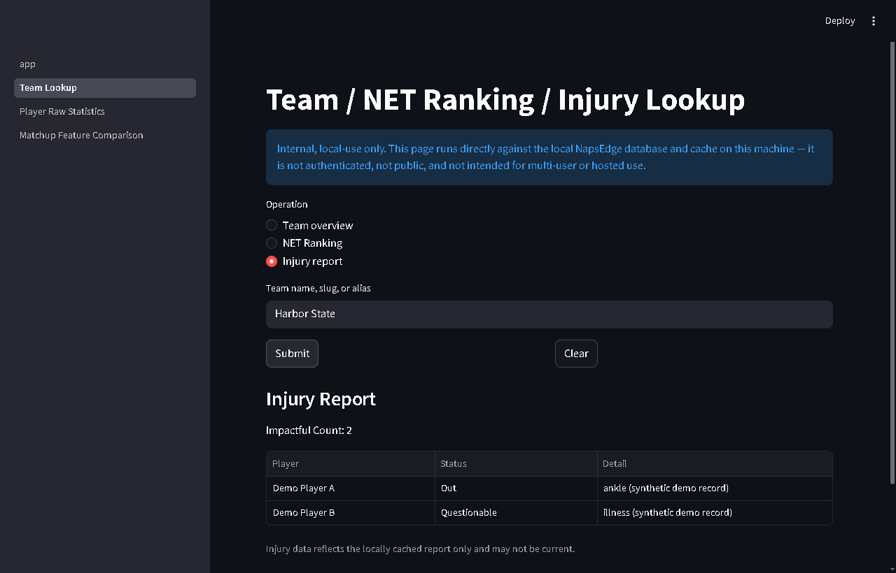
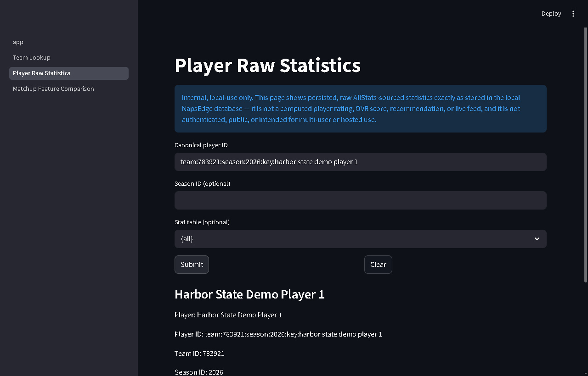
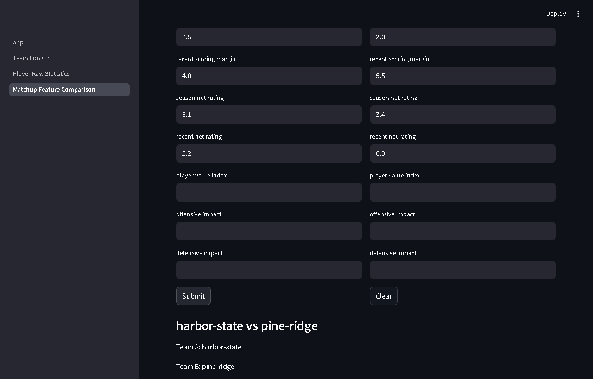

# NapsEdge: NCAA basketball analytics platform (engineering showcase)

[](https://github.com/aynapss/napsedge-showcase/actions/workflows/ci.yml)

NapsEdge collects NCAA men's basketball data, models matchups and serves the results through an API, a Streamlit app and a Discord bot. This repository is a **curated, view-only excerpt** of the private project. It shows the production engineering. The modelling, projection and betting-analysis components are proprietary and are not included (see [What is not here](#what-is-not-here)).

**Copyright (c) 2026 Anthony Napoli. All rights reserved.** Published for viewing only; see [NOTICE](NOTICE).

## Architecture

```
            SSH tunnel only (no public ingress)
                         │
        ┌────────────────┼─────────────────┐
        ▼                ▼                 ▼
   FastAPI service   Streamlit app    Discord worker
   (Bearer keys,     (private only)   (trusted guild)
   rate limiting)
        │                │                 │
        └────────► PostgreSQL 16 ◄─────────┘
                         │
          nightly logical backup, age-encrypted,
          copied off-site to Backblaze B2, restore-drilled
```

- **Python 3.13**, FastAPI, Streamlit, discord.py, SQLAlchemy 2 and Alembic, PostgreSQL 16, Redis (optional), Docker and Compose, systemd, GitHub Actions.
- One container image per process from a pinned base; every dependency is pinned exactly in [`constraints-release-py313.txt`](constraints-release-py313.txt).

## Engineering highlights

| Area | What it does | Where |
|---|---|---|
| API | Versioned read-only routes; sanitized errors that never leak internals; health and readiness endpoints | [`src/api/main.py`](src/api/main.py), [`src/api/routes/`](src/api/routes/) |
| Authentication | Bearer API keys stored only as SHA-256 digests and compared in constant time | [`src/auth/api_keys.py`](src/auth/api_keys.py) |
| Shared rate limiting | A fixed-window limiter shared across workers through one atomic Redis Lua script; fails **closed** on an outage | [`src/auth/rate_limit_redis.py`](src/auth/rate_limit_redis.py), [`src/auth/rate_limit_backend.py`](src/auth/rate_limit_backend.py) |
| Secrets | Read from read-only credential files (systemd credentials); URLs may not carry passwords; every secret read is registered for log redaction | [`src/secret_files.py`](src/secret_files.py) |
| Observability | Structured JSON logs, a request-correlation ID per request, a redaction filter, a data-freshness check | [`src/logging_config.py`](src/logging_config.py), [`src/api/request_context.py`](src/api/request_context.py), [`src/services/freshness.py`](src/services/freshness.py) |
| Backups | Consistent `pg_dump` snapshots under an advisory lock; a manifest-verified artifact format; `age` encryption; off-site copies with read-back verification; grandfather-father-son retention; restore drills that compare row-level evidence | [`src/deployment/`](src/deployment/), [`docs/backup_artifact_contract_proposal.md`](docs/backup_artifact_contract_proposal.md), [`docs/backup_operations_runbook.md`](docs/backup_operations_runbook.md) |
| Deployment | Startup validation that fails fast on bad configuration; systemd units and timers; an on-host check that the private services listen on loopback only | [`src/deployment/env_validation.py`](src/deployment/env_validation.py), [`deploy/`](deploy/), [`deploy/app/check-private-exposure.sh`](deploy/app/check-private-exposure.sh) |
| Database | SQLAlchemy models, repositories with idempotent upserts, Alembic migrations, least-privilege roles | [`src/db/`](src/db/), [`alembic/`](alembic/), [`docs/database_schema.md`](docs/database_schema.md) |
| Readiness | A threat assessment, a dependency-ordered hardening roadmap and an evidence-based go/no-go record | [`docs/phase9_deployment_hardening_readiness.md`](docs/phase9_deployment_hardening_readiness.md), [`docs/phase9f_go_no_go.md`](docs/phase9f_go_no_go.md) |

## Try the demo

Runs the real API and Streamlit images against a throwaway PostgreSQL, filled with **fictional teams and synthetic statistics** from [`demo/`](demo/). Needs Docker; everything stays on your machine.

```bash
docker compose -f compose.demo.yaml up --build --wait
python demo/smoke_demo.py          # 13 checks across every API route and Streamlit
```

- **Streamlit:** http://localhost:8501. Try *Team Lookup* with `Harbor State` (injury report, NET ranking), *Player Raw Statistics* with `team:783921:season:2026:key:harbor state demo player 1`, and *Matchup Feature Comparison* with any values.
- **API docs:** http://localhost:8000/v1/docs. Authorize with the public demo token `napsedge-demo-token`:

```bash
curl -H "Authorization: Bearer napsedge-demo-token" "http://localhost:8000/v1/teams/resolve?query=Harbor%20State"
curl -H "Authorization: Bearer napsedge-demo-token" "http://localhost:8000/v1/rankings/net"
```

Stop and remove everything with `docker compose -f compose.demo.yaml down -v`.

| Injury report | Player statistics | Matchup comparison |
|---|---|---|
|  |  |  |

How it works: the application code is unchanged; the image copies the demo files to the paths the code already reads (a team registry, a rankings cache, per-team injury files), and a one-shot `demo-setup` service runs the migrations and [`demo/seed_demo.py`](demo/seed_demo.py). The demo token and database password are public on purpose and only work against this local demo.

## Tests

```bash
python -m pip install -c constraints-release-py313.txt -r requirements-dev.txt -r requirements-backup.txt
python -m pytest -q
```

The default suite is self-contained (no network, no database). The PostgreSQL and Redis suites (`-m postgres`, `-m redis`) start disposable containers through Docker. CI runs the default suite, a `pip-audit` dependency scan, and the demo (build, boot, smoke test) on every push.

## What is not here

These stay in the private repository:
- the research notebooks;
- matchup feature engineering, the projection model and market-edge evaluation ([`src/features/matchup_features.py`](src/features/matchup_features.py) keeps only the descriptive comparison of user-supplied values; `build_matchup_features` raises `NotImplementedError`);
- player ratings, simulation, staking, calibration and back-testing;
- the LLM research agents and the legacy Discord commands;
- raw data, caches and team logos.

The container images build here from the fictional demo data instead of the private files.
