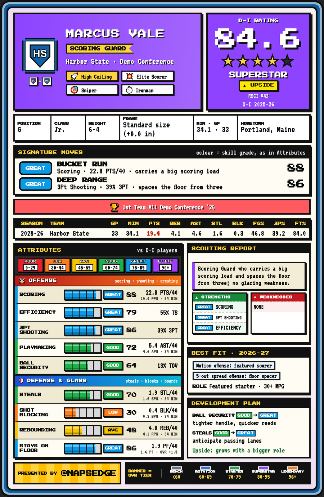
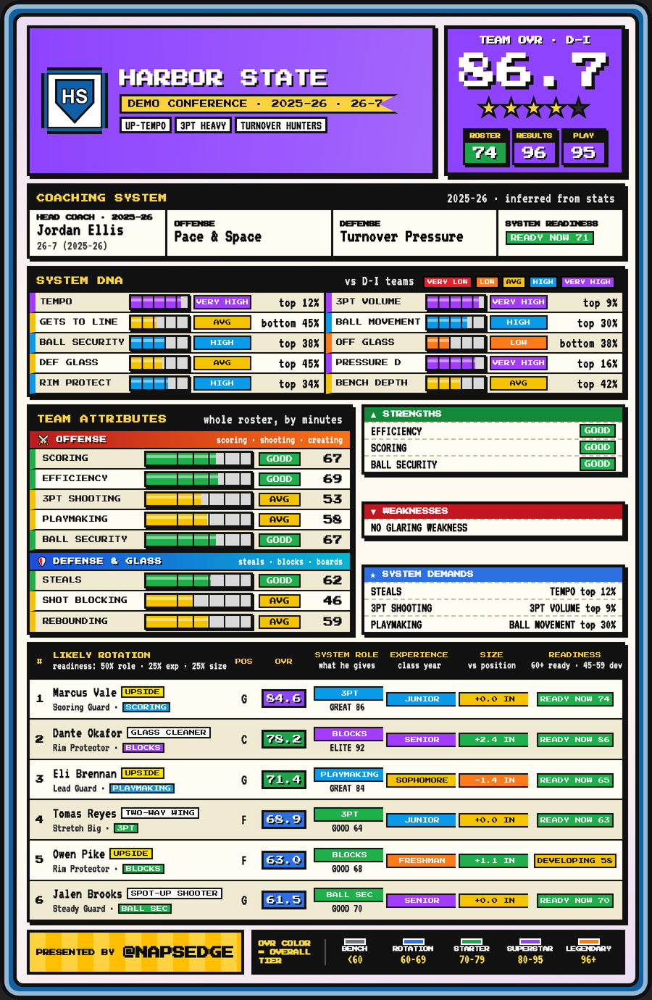
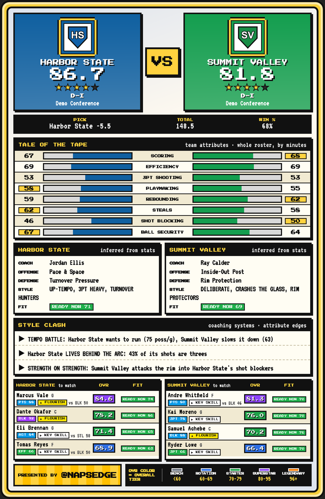
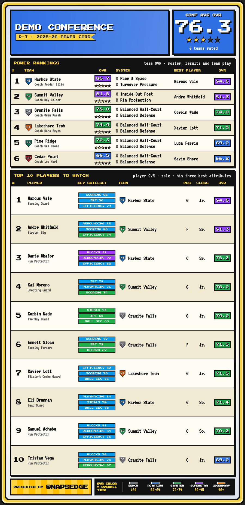

# How NapsEdge evaluates players and teams

This page explains the methodology behind NapsEdge's player cards, team cards, matchup cards and conference power cards: what goes in, how each number is built, and how the results are checked. The model code, its weights and its tuned constants are proprietary and stay in the private repository; everything here is described in plain terms.

The sample cards below use **fictional players, teams and coaches**. They are drawn by the real renderer from invented numbers.

| Player card | Team card | Matchup card | Conference card |
|---|---|---|---|
|  |  |  |  |

## Contents

1. [The pipeline at a glance](#the-pipeline-at-a-glance)
2. [Collecting the data](#collecting-the-data)
3. [The player rating (OVR)](#the-player-rating-ovr)
4. [Players below Division I](#players-below-division-i)
5. [Upside: a layered, tested profile](#upside-a-layered-tested-profile)
6. [The new season: exhibitions, then current play first](#the-new-season-exhibitions-then-current-play-first)
7. [The team rating](#the-team-rating)
8. [Coaching systems: System DNA](#coaching-systems-system-dna)
9. [Readiness: how a player fits a system](#readiness-how-a-player-fits-a-system)
10. [Matchups and conferences](#matchups-and-conferences)
11. [Running it every day](#running-it-every-day)
12. [How the numbers are checked](#how-the-numbers-are-checked)
13. [Next: incoming players](#next-incoming-players)

## The pipeline at a glance

```
 school sites, Sports-Reference, NCAA directory          (polite crawlers: robots.txt, rate limits)
            │
            ▼
 season files per team  ─────►  head coach + season results per team
            │                               │
            ▼                               ▼
 player ratings (OVR, skills)      coaching-system table per division
            │                               │
            └──────────────┬────────────────┘
                           ▼
        team rating · readiness · style clash · power rankings
                           │
                           ▼
        8-bit cards (web + Discord) · API · Streamlit · Discord bot
```

## Collecting the data

| What | Where it comes from | How often |
|---|---|---|
| Division I season statistics, records, strength of schedule, offensive and defensive ratings, head coach | Each team's Sports-Reference season page | Daily in season |
| Division I head coaches before the new season is published | Each school's own athletics site (roster or coaches page), from the NCAA member directory's list of 365 sites | Weekly |
| NCAA Division II and III statistics, rosters, game-by-game results, head coaches | Each school's own athletics site | Weekly |
| Junior-college statistics | The NJCAA's statistics service (switched off until the NJCAA grants permission) | Weekly |

Every crawler identifies itself honestly, reads and obeys each site's robots.txt, keeps to a per-site rate limit, and stops asking a site that refuses. One failing school never stops a run; every run writes a status file saying what was refreshed, what was not there and what failed. Data from below Division I stays private until each source permits publishing.

**Names are matched exactly, never guessed.** An early fuzzy matcher once filed "Boston" under Houston; every team is now matched to an exact entry in a team registry, and a name that matches nothing is reported for a person to check. Head-coach names are cleaned of decoration (a class year as in "Jordan Ellis '08", a nickname as in "Raymond 'Ray' Calder") so the same person written two ways is not mistaken for a coaching change.

## The player rating (OVR)

**Inputs: eight skills, each per 40 minutes or as a rate.** Scoring, shooting efficiency, three-point shooting, playmaking, rebounding, steals, shot blocking and ball security.

**Measured against the player's own division.** Each skill is compared with the average for his division and season, so a Division II player is rated against Division II, and a shot blocker's 2.0 blocks is judged against what is normal. On the card a skill's score is 50 at the division average; the levels are POOR (under 30), LOW, AVG, GOOD, GREAT and ELITE (90+).

**Position-aware.** A guard is sold on his shooting first and is not marked down for rebounding or blocks; a center is not judged on three-point shooting or playmaking; a forward is not judged on playmaking. A strong skill outside the position's job is still credited.

**Context adjustments.** The skills combine into one OVR with role and consistency adjustments: minutes and games played (a small sample is held back), a recency factor from the last 5 and 10 games, and, for Division I, conference strength. Size counts for the position: height is compared with the Division I average for guards, forwards and centers, so a 6-6 guard is big and a 6-8 center is undersized.

**Graded against his league and position.** Each attribute is shown as a percentile among players of the same league and position group (a guard against guards), on five equal bands: POOR, LOW, AVG, GOOD, GREAT, ELITE.

**Every number says what it is.** Counting skills are shown per 40 minutes with the per-game number and minutes under them ("22.1 PTS/40 · 17.8 PPG · 32 MIN"), so a high scoring grade in limited minutes is explained rather than doubted; rates name their stat ("61% TS", "14% TOV").

**Staying on the floor.** Fouls per 40 minutes, against his league and position, fewer grading higher. It is its own row on the card and a small, capped adjustment to the overall: a player who stays out of foul trouble is worth more minutes.

**Tiers.** BENCH (under 60), ROTATION (60-69), STARTER (70-79), SUPERSTAR (80-95), LEGENDARY (96+).

**The scouting report is rules on his own numbers, not a language model.** Strengths and weaknesses cite the player's level and his own per-game numbers; the role title ("Scoring Guard", "Rim Protector") and the systems he suits follow from his best skills and position; the development plan names the next level for his weakest key skills, with polishing rather than rebuilding for a player in his final season.

## Players below Division I

A Division II, Division III or junior-college player is first rated against his own division. For a player moving up, the card also shows a **Division I projection**: his own-division OVR mapped onto the Division I scale with a curve calibrated on players who actually made the move, then adjusted for skills that transfer well and for pedigree (recruiting stars, All-America and conference honors). The card says which number it shows ("NCAA DII RATING" or "D-I PROJECTION") and where the rating came from.

Expected growth for a returning player comes from a study of 631 Division II and III players who stayed at the same school between two seasons: growth by starting level, class year, upside and role. A player in his final season shows no further growth.

## Upside: a layered, tested profile

An upside label has to be defensible from the player's own numbers. The first version, a single-season index, was tested against what players actually did the next season and failed: players it called "elite upside" grew the *least*. It was replaced by a profile of five layers, each ranked within his league and position:

| Layer | What it measures |
|---|---|
| Runway | Seasons of eligibility left |
| Trajectory | His rating change last season |
| Headroom | Efficient production in a small role (true shooting and points per 40, weighted by how little he plays; a minimum sample applies) |
| Tools | Size for his position, steals, blocks and offensive rebounds |
| Pedigree | National recruiting rank |

The layers' weights were **fitted to real growth**: every rated Division I player across three seasons, about 5,800 player-season pairs, predicting his next-season rating change. Tested on teams held out of the fit:

| Predicting next-season rating change | Correlation |
|---|---|
| Layered profile | **0.43** |
| Previous upside badge | 0.07 |
| Current rating alone | 0.40 |

Most of the predictability is regression toward the middle (lower-rated players rise, the highest fall back), so labels rank only the growth the layers add beyond what a player's current rating predicts. Three labels by share of each league and position: **Star Ceiling**, **High Ceiling**, **Stock Rising**; a player in his final season or already rated 90+ gets none. The card shows his national recruiting rank under the label when he has one (e.g. "RSCI #38"); the other layers count in the score without crowding the card. Individual growth stays noisy (a typical miss is several rating points), and the card says what the label rests on rather than overstating it.

## The new season: exhibitions, then current play first

**Exhibitions** are read from each school's own box scores (no statistics site carries them), kept once and never fetched again. They are rated like a season at the same per-game rates and nudge the preseason rating by a small weight that grows with minutes, counted at a discount because starters rest and opponents vary. One exhibition moves a player a few percent of the way at most.

**Once real games start, this season leads.** A player's rating and every attribute blend this season with his history (his preseason card, else last season), and this season's share grows with his minutes: a regular starter is mostly this season by midseason. Exhibitions then stay only inside the preseason history, worth far less than regular-season and postseason games. A team's rating follows from its players.

## The team rating

A team's OVR blends three things, each on the same scale:

| Part | Weight | What it measures |
|---|---|---|
| **Roster** | 40% | Every rated player's OVR, weighted by his share of the team's minutes |
| **Results** | 35% | Winning percentage and how much the team won by (Sports-Reference's schedule-adjusted SRS for Division I; scoring margin below it), each ranked within the division |
| **Team play** | 25% | The team's own statistics (points per possession, shooting, ball security, rebounding, three-point shooting, ball movement, rim protection, pressure), ranked within the division and weighted by how closely each tracks NET ranking |

Together the team-play statistics follow NET ranking with a rank correlation of 0.73 across 279 Division I teams. They are offense-heavy, because a season file holds a team's own numbers rather than its opponents', so defense enters through steals, blocks and rebounds, and through results.

Before a team has played (a projected roster for the coming season) the rating is the roster alone, and the card says so. Team attributes on the card are the roster's: every player's skill scores, weighted by minutes, so they describe the players rather than the coach's style.

## Coaching systems: System DNA

A program's system is measured from its own season, not from a description of it. Ten traits:

| Trait | Measured as |
|---|---|
| Tempo | Possessions per game |
| 3PT volume | Share of shots that are threes |
| Gets to the line | Free-throw attempts per shot |
| Ball movement | Assists per made basket |
| Ball security | Possessions without a turnover |
| Offensive glass | Offensive rebounds per missed shot |
| Defensive glass | Defensive rebounds per possession |
| Pressure defense | Steals per possession |
| Rim protection | Blocks per possession |
| Bench depth | Share of minutes played outside the top five |

Each trait is ranked among the teams of the same division and season and shown as a level (VERY LOW, LOW, AVG, HIGH, VERY HIGH) with a plain rank ("top 8%", "bottom 2%"). The strongest traits name an offensive and a defensive style (for example *Pace & Space*, *Motion / Ball Movement*, *Half-Court Grind*; *Turnover Pressure*, *Rim Protection*), and the most extreme give the team its tags ("UP-TEMPO", "RIM PROTECTORS").

**Style is not re-labelled on a few games.** Early in a season a team keeps its established style (its coach's last season, or a new coach's from his previous program) until it has played enough games and its DNA has clearly moved; then the card says the style changed.

**The system follows the coach.** Each season's head coach is recorded from the pages the crawlers already read. When a program hires a new coach, its card takes the System DNA from that coach's most recent season at his previous program (in that program's division) and says so, with his record there. A returning coach keeps his own team's system. A coach recorded by hand with a source (a named scheme, for instance) overrides what the statistics infer.

## Readiness: how a player fits a system

Each team card lists its top eight players by OVR with a readiness verdict and its three reasons:

| Factor | Weight | What it means |
|---|---|---|
| **System role** | 50% | The system's three strongest demands map to skills (rim protection asks for shot blocking, ball movement for playmaking, and so on); this is the demand the player fills best, at his level in it |
| **Experience** | 25% | Class year, freshman to graduate |
| **Size** | 25% | Height against the Division I average for his position |

READY NOW (60+), DEVELOPING (45-59) or PROJECT (under 45). Minutes from a previous season are deliberately not used: a transfer's or a breakout player's old role says little about his new one.

## Matchups and conferences

**Matchup card.** Both team ratings, a tale of the tape across the eight team attributes, both coaching systems, and a *style clash* in plain words drawn from the two systems' DNA: a tempo battle when one team plays much faster, a turnover edge when one team's pressure meets the other's loose handle, second-chance edges, rim attacks into shot blockers, three-point volume and bench depth. The style clash also names the widest gaps between the two teams' attributes. Each team's four players to watch carry the one skill this matchup favours: of his three best attributes, the one the opponent is least equipped to stop, judged against the opponent's team attribute that tests it (its shot blocking for a scorer, its rebounding for a rebounder, its ball security for a pickpocket). It is tagged **FLOURISH** when the opponent is weak there or the skill is a star skill, **TOUGH TEST** when the opponent is strong there, and **KEY SKILL** otherwise.

**Conference power card.** Teams ranked by team OVR with their tiers and styles, and the conference's best players.

## Running it every day

One scheduled refresh covers every league in about 40 minutes. Sites never share a request budget, so two lanes run at once: Sports-Reference (one host, held to its published rate limit, which sets the floor) and the schools' own sites, read in parallel, one request at a time per site. Box scores already kept are never fetched again, a season that is not published yet is detected from a few pages and skipped, and the head-coach check runs in the offseason, when coaches change.

The server version of the same jobs, each in its own hardened container (read-only filesystem, unprivileged user, no capabilities):

| Job | When |
|---|---|
| Division I season pages, injuries | Daily, 03:00 ET |
| Lower-division season pages, results and coaches | Weekly, Monday 04:30 ET |
| Division I coach check across 365 school sites | Weekly, Monday 06:00 ET |
| Cards: every changed team's player, team and conference cards | Daily, 07:30 ET |

The card job redraws only the teams whose season file changed since its last run (a fingerprint per team), rebuilds each division's System DNA table once, and draws in one shared headless browser, optionally across several processes: about 1.2 seconds a card. Only the card image carries a browser; the API, Streamlit and Discord images do not.

Each card is saved twice, a full-resolution PNG for the web and a 256-colour copy for Discord, filed by division, conference, team and season.

## How the numbers are checked

- **Parity with the research model.** The production rating code is a port of the original research notebook; a test runs both on the same player's real data with the same benchmark and requires them to agree to within 0.05 points, including the recency adjustment from his game logs.
- **Snapshot discipline.** Tests that pin values from real data say which data snapshot they come from. When a data refresh moves a value, the cause is investigated before any expected value changes, and a gap that turns out to be a real difference between two implementations is fixed at its source rather than hidden by a new tolerance.
- **Layout checks.** Card sections are measured for clipped text and dead space before a design change is accepted.
- **Every scraper and parser is tested on the real pages' markup**, including the failure paths: a page that does not exist, a site that refuses, a redirect to another host, a malformed address.

## Next: incoming players

Freshmen and international signees are projected from recruiting rankings until they play. The next step is a stats-based projection from grassroots and international play (Nike EYBL, FIBA youth events, Overtime Elite, the Next Generation Tournament), translated to each college level the same way lower-division ratings are: fitted on players seen at both levels, kept only if it beats recruiting rankings alone, and shown with its expected error. Several of these sources are licensed data; nothing is collected without the source's permission, and because most of these players are minors only published game statistics are used.
